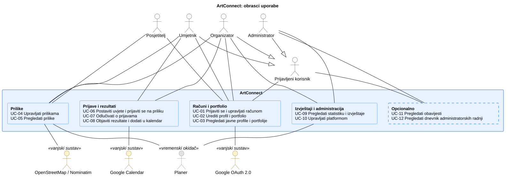

# 3. Obrasci uporabe

**Cilj:** Prikazati interakcije između aktera i sustava ArtConnect. Svaki obrazac opisuje kako akter ostvaruje svoj cilj i što se događa kad važan korak ne uspije. Obrasci su izvedeni iz odobrenih funkcijskih zahtjeva ([analiza zahtjeva](2-Analiza-zahtjeva.md#21-funkcijski-zahtjevi)).

## 3.1 Dijagram obrazaca uporabe

**Slika 3.1. Dijagram obrazaca uporabe sustava ArtConnect** · **PlantUML izvor:** [izvor](puml/3-1-artconnect-system-UC.puml)

Detaljni dijagrami po skupinama obrazaca:

- [Računi i portfolio](puml/3-1-artconnect-racuni-UC.puml) (`assets/diagrams/3-1-artconnect-racuni-UC.svg`)
- [Prilike](puml/3-1-artconnect-prilike-UC.puml) (`assets/diagrams/3-1-artconnect-prilike-UC.svg`)
- [Prijave i rezultati](puml/3-1-artconnect-prijave-UC.puml) (`assets/diagrams/3-1-artconnect-prijave-UC.svg`)
- [Izvještaji i administracija](puml/3-1-artconnect-izvjestaji-UC.puml) (`assets/diagrams/3-1-artconnect-izvjestaji-UC.svg`)

| ID | Obrazac uporabe | Akter(i) |
| --- | --- | --- |
| UC-01 | Prijaviti se i upravljati računom | Posjetitelj, prijavljeni korisnik, Google OAuth 2.0 |
| UC-02 | Urediti profil i portfolio | Umjetnik, organizator |
| UC-03 | Pregledati javne profile i portfolije | Posjetitelj |
| UC-04 | Upravljati prilikama | Organizator, OpenStreetMap/Nominatim, Planer (automatsko zatvaranje) |
| UC-05 | Pregledati prilike | Posjetitelj, umjetnik, OpenStreetMap/Nominatim |
| UC-06 | Postaviti uvjete i prijaviti se na priliku | Organizator, umjetnik |
| UC-07 | Odlučivati o prijavama | Organizator, umjetnik |
| UC-08 | Objaviti rezultate i dodati u kalendar | Organizator, umjetnik, Google Calendar |
| UC-09 | Pregledati statistiku i izvještaje | Organizator, administrator, Planer |
| UC-10 | Upravljati platformom | Administrator |
| UC-11 | Pregledati obavijesti **(opcionalno)** | Prijavljeni korisnik |
| UC-12 | Pregledati dnevnik administratorskih radnji **(opcionalno)** | Administrator |

Veze između obrazaca i zahtjeva bit će u [matrici sljedivosti](2-Analiza-zahtjeva.md#26-sljedivost-zahtjeva) kad ona bude ispunjena.

## 3.2 Specifikacije obrazaca uporabe

### UC-01 Prijaviti se i upravljati računom

| Element specifikacije | Opis |
| :--- | :--- |
| **Primarni akter** | Posjetitelj (prijava); prijavljeni korisnik (upravljanje računom) |
| **Vanjski akter** | Google OAuth 2.0 |
| **Povezani zahtjevi** | FR-01 |
| **Preduvjeti** | Korisnik ima Google račun. |
| **Glavni uspješni tok** | 1. Posjetitelj se prijavi Google računom. 2. Sustav stvara ili prepoznaje korisnika i uspostavlja sesiju. 3. Novi korisnik odabire ulogu umjetnika ili organizatora (`POST /api/v1/me/role`). 4. Sustav aktivira račun i preusmjerava korisnika na profil. |
| **Alternativni tokovi** | **3a — Uloga je već odabrana:** sustav vraća `409 ROLE_ALREADY_CHOSEN`. **3b — Prije odabira uloge:** ostale rute vraćaju `403 ONBOARDING_REQUIRED`. **3c — Pozvani korisnik:** unaprijed dodijeljena uloga aktivira se prijavom, a odabir se preskače. |
| **Rezultat** | Korisnik ima ulogu i aktivan račun. Brisanje računa planirano je u zadatku AUTH-04. |

Detalji su u [API dokumentaciji prijave](api/auth.md).

### UC-02 Urediti profil i portfolio

| Element specifikacije | Opis                                                                                                                                                                                                                                                                                                                                                                                                                                                                                                                                                                                                                                                                                                                                                                                                                                                                                                                                                                                                                                                                                                                    |
| :--- |-------------------------------------------------------------------------------------------------------------------------------------------------------------------------------------------------------------------------------------------------------------------------------------------------------------------------------------------------------------------------------------------------------------------------------------------------------------------------------------------------------------------------------------------------------------------------------------------------------------------------------------------------------------------------------------------------------------------------------------------------------------------------------------------------------------------------------------------------------------------------------------------------------------------------------------------------------------------------------------------------------------------------------------------------------------------------------------------------------------------------|
| **Primarni akter** | Umjetnik, organizator                                                                                                                                                                                                                                                                                                                                                                                                                                                                                                                                                                                                                                                                                                                                                                                                                                                                                                                                                                                                                                                                                                   |
| **Povezani zahtjevi** | FR-02                                                                                                                                                                                                                                                                                                                                                                                                                                                                                                                                                                                                                                                                                                                                                                                                                                                                                                                                                                                                                                                                                                                   |
| **Preduvjeti** | Korisnik je prijavljen s ulogom `ARTIST` ili `ORGANIZER`.                                                                                                                                                                                                                                                                                                                                                                                                                                                                                                                                                                                                                                                                                                                                                                                                                                                                                                                                                                                                                                                               |
| **Glavni uspješni tok** | 1. Umjetnik uređuje umjetnički profil (`PUT /api/v1/me/artist-profile`) i otvara popis vlastitih djela (`GET /api/v1/artists/{artistId}/artworks`). 2. Umjetnik odabire dodavanje djela, unosi naslov, godinu, tehniku, dimenzije, opis i vidljivost te sprema, može dodati i slike (`POST /api/v1/artworks`). Nakon stvaranja sustav vraća natrag na portfolio; dodavanje slika ne mora se obavljati zasebno. 3. Umjetnik uređuje postojeće djelo (`PUT /api/v1/artworks/{artworkId}`) ili ga odabire za brisanje s popisa ili obrasca. 4. Sustav sprema promjene i prikazuje ih na javnom profilu. 5. Organizator uređuje naziv organizacije (`PUT /api/v1/me/organizer-profile`).                                                                                                                                                                                                                                                                                                                                                                                                                        |
| **Alternativni tokovi** | **1a — Umjetnik pregledava vlastiti popis:** prikazuju se sva njegova djela, uključujući `PRIVATE` i skrivena od administratora; prikazuju se najviše dva reda, a ostala djela dostupna su na sljedećim stranicama; straničenje se zadržava u URL-u. **2a — Nevaljani unos:** klijentska validacija ili odgovor `400 VALIDATION_ERROR` prikazuje grešku uz odgovarajuće polje i ništa ne sprema. **2b — Djelo s vidljivošću `PRIVATE`:** ne prikazuje se javno. **2c — Prazno polje dimenzija ili opisa:** sprema se kao `null` i briše prethodnu vrijednost. **2d — Djelo nije pronađeno:** sustav prikazuje obavijest „Djelo nije pronađeno” i povratak na portfolio. Tuđe javno djelo ne tretira se kao nepostojeće. **3a — Nespremljene promjene:** pri napuštanju obrasca sustav traži potvrdu prije odbacivanja unosa. **3b — Brisanje djela:** sustav traži potvrdu; nakon potvrde briše djelo i slike. Ako je uklonjena posljednja stavka na stranici, sustav prikazuje prethodnu stranicu. **3c — Brisanje ne uspije:** djelo ostaje prikazano, a sustav obavještava umjetnika o pogrešci. |
| **Rezultat** | Profil i portfolio su ažurirani; umjetnik može pregledavati, dodavati, uređivati i brisati vlastita djela.                                                                                                                                                                                                                                                                                                                                                                                                                                                                                                                                                                                                                                                                                                                                                                                                                                                                                                                                                                                                              |

Detalji su u [API dokumentaciji umjetnika](api/artists.md) i [djela](api/artworks.md).

### UC-03 Pregledati javne profile i portfolije

| Element specifikacije | Opis |
| :--- | :--- |
| **Primarni akter** | Posjetitelj |
| **Povezani zahtjevi** | FR-02, FR-07 |
| **Preduvjeti** | Nema; pregled ne traži prijavu. |
| **Glavni uspješni tok** | 1. Posjetitelj otvara javnu poveznicu `/artists/{userId}`; prijava nije potrebna. 2. Sustav prikazuje profil umjetnika, javna djela i prethodne izložbe, uz paginaciju galerije. 3. Posjetitelj otvara djelo u dijalogu i pregledava njegove slike. |
| **Alternativni tokovi** | **2a — Djelo nije javno ili ga je administrator sakrio:** djelo se ne prikazuje; vlasniku se u javnom prikazu također prikazuju samo javna i neskrivena djela. **2b — Profil nema javnih djela:** prikazuje se poruka da umjetnik još nema javnih djela. **2c — Zatražena stranica galerije izvan je raspona:** URL se ne preusmjerava; prikazuje se prazno stanje s mogućnošću povratka na dostupnu stranicu. **2d — Profil ne postoji ili više nije dostupan:** sustav prikazuje „Umjetnik nije pronađen”. **2e — Greška poslužitelja:** sustav prikazuje grešku s mogućnošću ponovnog pokušaja. **3a — Dijalog djela:** zatvara se tipkom Escape, a slike se mijenjaju strelicama; zatvaranjem se vraća fokus na otvoreno djelo. |
| **Rezultat** | Posjetitelj vidi javni portfolio umjetnika, a vlasnik može otvoriti uređivanje profila ili kopirati javnu poveznicu. |

### UC-04 Upravljati prilikama

| Element specifikacije | Opis |
| :--- | :--- |
| **Primarni akter** | Organizator (vlasnik prilike) |
| **Vanjski akter** | OpenStreetMap/Nominatim (geokodiranje adrese), Planer (automatsko zatvaranje prijava nakon roka) |
| **Povezani zahtjevi** | FR-03, FR-04 |
| **Preduvjeti** | Organizator ima aktivan račun s ulogom `ORGANIZER` i prijavljenu sesiju. |
| **Glavni uspješni tok** | 1. Organizator unosi naslov, opis, vrstu, područja umjetnosti, rok i lokaciju (fizička s koordinatama ili online s poveznicom); sustav sprema nacrt u statusu `PREPARATION`. 2. Organizator uređuje priliku (`PUT /api/v1/opportunities/{id}`); status ostaje isti. 3. Organizator pregledava svoje prilike (`GET /api/v1/me/opportunities`) i filtrira ih po statusu ili arhiviranosti. 4. Organizator mijenja status prilike (`POST /api/v1/opportunities/{id}/status`): `PREPARATION` → `OPEN`, `OPEN` → `CLOSED` ili `CLOSED` → `SELECTION`. 5. Organizator briše priliku ili je arhivira. |
| **Alternativni tokovi** | **1a — Nevaljani unos ili rok u prošlosti:** sustav odbija spremanje (`400`). **1b — Adresa nije pronađena:** organizator ručno odabire koordinate na karti. **3a — Pregled bez prilika:** prazan popis uz podatke o stranici. **4a — Nedopušten prijelaz** (npr. isti status ili `FINISHED`): `409 INVALID_STATUS_TRANSITION`, a `FINISHED` postiže se samo objavom rezultata (UC-08). **4b — Otvaranje s rokom u prošlosti:** `409 DEADLINE_PASSED`; prijelaz `PREPARATION` → `OPEN` i `CLOSED` → `OPEN` traže rok u budućnosti. **4c — Objava bez odobrenja:** dok ADM-02-BE nije gotov, svi organizatori smatraju se odobrenima; nakon toga prvo otvaranje bez odobrenja vraća `403 ORGANIZER_NOT_APPROVED`. **4d — Arhivirana prilika:** svaka promjena statusa odbijena je s `409 INVALID_STATUS_TRANSITION`. **5a — Prilika ima prijave:** brisanje je odbijeno (`409 HAS_APPLICATIONS`), a organizator može samo arhivirati. **5b — Automatsko zatvaranje:** Planer zatvara prijave kad rok istekne (zadatak OPP-04, 2. ciklus). |
| **Rezultat** | Prilika je spremljena, uređena, arhivirana ili obrisana. |

Detalji su u [API dokumentaciji prilika](api/opportunities.md), za [pregled](api/opportunities.md#get-apiv1meopportunities) i [promjenu statusa](api/opportunities.md#post-opportunitiesopportunityidstatus).

#### Objava prilike

| Element specifikacije | Opis |
| :--- | :--- |
| **Primarni akter** | Organizator |
| **Povezani zahtjevi** | FR-03; OPP-01-FE2 |
| **Preduvjeti** | Korisnik je prijavljen s ulogom `ORGANIZER`. Ruta `/organizer/opportunities/new` zaštićena je provjerom uloge. |
| **Glavni uspješni tok** | 1. Organizator otvara obrazac za novu priliku. 2. Sustav dohvaća aktivne vrste prilika i područja umjetnosti (`GET /api/v1/opportunity-types`, `GET /api/v1/art-fields`). 3. Organizator unosi naslov, opis, vrstu, jedno do deset područja, rok prijave te po želji kriterije, nagradu i datume događanja. 4. Sustav provjerava unos prema pravilima `OpportunityInput`. Rok mora biti u budućnosti; kraj događanja može se unijeti samo uz početak i ne može mu prethoditi. 5. Datumi i vremena prikazuju se u vremenskoj zoni `Europe/Zagreb` i šalju kao ISO-8601 vrijednosti s pomakom. 6. Organizator sprema obrazac (`POST /api/v1/opportunities`). Sustav stvara priliku u statusu `PREPARATION`, osvježava relevantne podatke, prikazuje poruku „Prilika je spremljena” i vodi na `/opportunities/{id}`. |
| **Alternativni tokovi** | **2a — Dohvat nije uspio:** sustav prikazuje stanje pogreške i omogućuje ponovni pokušaj. **4a — Nevaljan unos:** poruke validacije prikazuju se uz pripadajuća polja, a zahtjev se ne šalje. **6a — API vraća `400 VALIDATION_ERROR`:** detalji pogreške mapiraju se na polja obrasca. **6b — API vraća `403`:** sustav obavještava organizatora da nema pristup. **6c — Druga pogreška poslužitelja:** prikazuje se obavijest o pogrešci; unesene vrijednosti ostaju u obrascu. **7a — Pokušaj napuštanja s nespremljenim promjenama:** sustav traži potvrdu prije odbacivanja unosa. |
| **Rezultat** | Nova prilika spremljena je kao nacrt. |

#### Uređivanje prilike

| Element specifikacije | Opis |
| :--- | :--- |
| **Primarni akter** | Organizator (vlasnik prilike) |
| **Povezani zahtjevi** | FR-03; OPP-01-FE2 |
| **Preduvjeti** | Organizator je prijavljen s ulogom `ORGANIZER`, a prilika postoji i pripada mu. |
| **Glavni uspješni tok** | 1. Organizator otvara `/organizer/opportunities/{id}/edit`. 2. Sustav dohvaća priliku (`GET /api/v1/opportunities/{id}`) i aktivne šifrarnike te popunjava obrazac postojećim podacima. 3. Ako trenutačna vrsta ili područje umjetnosti nije među aktivnim opcijama, i dalje se prikazuje kao odabrano s oznakom „(neaktivno)” i ostaje u obrascu. 4. Organizator uređuje osnovna polja i datume. Pri uređivanju rok može biti u prošlosti; ostala pravila polja i datuma događanja vrijede kao pri stvaranju. 5. Organizator sprema promjene (`PUT /api/v1/opportunities/{id}`). Sustav osvježava relevantne podatke, prikazuje poruku „Prilika je spremljena” i vodi na `/opportunities/{id}`. |
| **Alternativni tokovi** | **2a — Dohvat je u tijeku:** sustav prikazuje stanje učitavanja. **2b — API vraća `403` ili `404`:** sustav prikazuje odgovarajuću poruku i poveznicu na „Moje prilike”. **2c — Druga pogreška poslužitelja:** prikazuje se stanje pogreške s mogućnošću ponovnog pokušaja. **4a — Nevaljan unos ili API `400 VALIDATION_ERROR`:** pogreške se prikazuju uz pripadajuća polja, uključujući polja lokacije kada ih dostavi lokacijska komponenta. **5a — Pokušaj napuštanja s nespremljenim promjenama:** sustav traži potvrdu prije odbacivanja unosa. |
| **Rezultat** | Postojeća prilika ažurirana je; njezin status i vlasnik ostaju nepromijenjeni. |

**Opseg OPP-01-FE2:** obrazac obuhvaća osnovna polja, datume, validaciju i spremanje. Odjeljak „Lokacija” zasad je mjesto za uključivanje zasebne komponente iz OPP-01-FE3, a „Zahtjevi prijave” mjesto za APP-01-FE1. Ti se odjeljci dovršavaju u pripadajućim podzadacima.

### UC-05 Pregledati prilike

| Element specifikacije | Opis |
| :--- | :--- |
| **Primarni akter** | Posjetitelj, umjetnik |
| **Vanjski akter** | OpenStreetMap/Nominatim (karta i pretraga lokacija) |
| **Povezani zahtjevi** | FR-04 |
| **Preduvjeti** | Nema; pregled ne traži prijavu. |
| **Glavni uspješni tok** | 1. Korisnik otvara popis prilika ili kartu. 2. Pretražuje i filtrira prilike (područje umjetnosti, vrsta prilike). 3. Otvara pojedinu priliku. |
| **Alternativni tokovi** | **2a — Arhivirana ili neobjavljena prilika:** ne prikazuje se u javnoj pretrazi. **2b — Kartografske pločice nisu dostupne:** sustav prikazuje upozorenje. |
| **Rezultat** | Korisnik vidi javno objavljene prilike. |

### UC-06 Postaviti uvjete i prijaviti se na priliku

| Element specifikacije | Opis |
| :--- | :--- |
| **Primarni akter** | Organizator (uvjeti), umjetnik (prijava) |
| **Povezani zahtjevi** | FR-05 |
| **Preduvjeti** | Prilika postoji i organizator je njezin vlasnik; za prijavu prijave su otvorene. |
| **Glavni uspješni tok** | 1. Organizator postavlja uvjete prijave (zadaci APP-01, APP-05). 2. Umjetnik pregledava uvjete i predaje prijavu (APP-02). 3. Umjetnik može prijavu povući ili dopuniti dok su prijave otvorene. |
| **Alternativni tokovi** | **2a — Prijave zatvorene:** predaja i dopuna nisu moguće. |
| **Rezultat** | Uvjeti su spremljeni; prijava je predana i vidljiva umjetniku. |

Detalji rute i odgovora bit će u API dokumentaciji prijava.

### UC-07 Odlučivati o prijavama

| Element specifikacije | Opis |
| :--- | :--- |
| **Primarni akter** | Organizator |
| **Sudionik** | Umjetnik (prati odluku) |
| **Povezani zahtjevi** | FR-06 |
| **Preduvjeti** | Umjetnik je predao prijavu na priliku organizatora. |
| **Glavni uspješni tok** | 1. Organizator otvara popis prijava na svoju priliku (APP-04). 2. Pregledava prijavu i prihvaća je ili odbija. 3. Sustav sprema odluku. 4. Umjetnik vidi odluku među svojim prijavama (APP-03). |
| **Alternativni tokovi** | **2a — Prijava nije pronađena ili pripada drugom organizatoru:** odluka se ne sprema. |
| **Rezultat** | Prijava je prihvaćena ili odbijena, a umjetnik vidi odluku. |

### UC-08 Objaviti rezultate i dodati u kalendar

| Element specifikacije | Opis |
| :--- | :--- |
| **Primarni akter** | Organizator (objava), umjetnik (pregled i kalendar) |
| **Vanjski akter** | Google Calendar |
| **Povezani zahtjevi** | FR-07 |
| **Preduvjeti** | Organizator ima prihvaćene prijave na priliku. |
| **Glavni uspješni tok** | 1. Organizator objavljuje rezultate prilike (RES-01). 2. Sustav prikazuje rezultate sudionicima i dodaje sudjelovanje na javni portfolio umjetnika (RES-02). 3. Umjetnik odabire dodavanje prihvaćenog događanja u Google kalendar (CAL-01). |
| **Alternativni tokovi** | **1a — Ispravak rezultata:** mijenja prikaz i na portfoliju (RES-03). **3a — Prijava nije prihvaćena:** događanje se ne može dodati. **3b — Izravno umetanje API-jem:** opcionalno (CAL-02). |
| **Rezultat** | Rezultati su vidljivi, a umjetnik može otvoriti kalendar s podacima događanja. |

### UC-09 Pregledati statistiku i izvještaje

| Element specifikacije | Opis |
| :--- | :--- |
| **Primarni akter** | Organizator (statistika), administrator (izvještaji) |
| **Vanjski akter** | Planer (mjesečni izvještaj) |
| **Povezani zahtjevi** | FR-08 |
| **Preduvjeti** | Organizator ima prilike; administrator je prijavljen s ulogom `ADMIN`. |
| **Glavni uspješni tok** | 1. Organizator otvara statistiku svojih prilika (STAT-01). 2. Planer jednom mjesečno generira izvještaj o korištenju platforme (REP-01). 3. Administrator pregledava izvještaje (REP-02). |
| **Alternativni tokovi** | **1a — Grafikoni:** opcionalni (STAT-02). **3a — Povijest i ručno generiranje:** opcionalni. |
| **Rezultat** | Organizator vidi statistiku svojih prilika, a administrator mjesečne izvještaje. |

### UC-10 Upravljati platformom

| Element specifikacije | Opis |
| :--- | :--- |
| **Primarni akter** | Administrator |
| **Povezani zahtjevi** | FR-09 |
| **Preduvjeti** | Administrator je prijavljen s ulogom `ADMIN`; za promjene je potreban CSRF token. |
| **Glavni uspješni tok** | 1. Administrator pregledava korisnike (`GET /api/v1/admin/users`) i filtrira ih po ulozi, statusu i odobrenju organizatora. 2. Mijenja uloge korisnika i odobrava organizatore (ADM-01, ADM-02). 3. Sakriva neprimjereni sadržaj (ADM-03). 4. Uređuje šifrarnike i postavke (ADM-04). |
| **Alternativni tokovi** | **2a — Neispravni parametri:** `400 VALIDATION_ERROR`. **4a — Stavka se koristi:** brisanje vraća `409 IN_USE`; administrator je može deaktivirati. **4b — Duplikat šifre ili naziva:** `409 DUPLICATE_CODE`. |
| **Rezultat** | Korisnici, odobrenja, sadržaj i šifrarnici su ažurirani. |

Detalji su u [API dokumentaciji administracije](api/admin.md).

### UC-11 Pregledati obavijesti (opcionalno)

| Element specifikacije | Opis |
| :--- | :--- |
| **Primarni akter** | Prijavljeni korisnik |
| **Povezani zahtjevi** | FR-10 |
| **Preduvjeti** | Korisnik je prijavljen. |
| **Glavni uspješni tok** | 1. Korisnik otvara popis obavijesti. 2. Sustav prikazuje obavijesti vezane uz njegov račun i aktivnosti. 3. Korisnik označava obavijest pročitanom (NOTIF-01, NOTIF-02). |
| **Alternativni tokovi** | **2a — Tuđe obavijesti:** nisu vidljive. |
| **Rezultat** | Korisnik vidi svoje obavijesti. |

### UC-12 Pregledati dnevnik administratorskih radnji (opcionalno)

| Element specifikacije | Opis |
| :--- | :--- |
| **Primarni akter** | Administrator |
| **Povezani zahtjevi** | FR-09 (dodatna mogućnost niskog prioriteta) |
| **Proširuje** | UC-10 Upravljati platformom |
| **Preduvjeti** | Administrator je prijavljen s ulogom `ADMIN`. |
| **Glavni uspješni tok** | 1. Administrator otvara zapisnik administratorskih radnji (ADM-05). 2. Sustav prikazuje zapise radnji. |
| **Alternativni tokovi** | **2a — Ostali korisnici:** ne mogu pregledavati zapisnik. |
| **Rezultat** | Administrator vidi zapisnik radnji. |

## 3.3 Provjera dosljednosti obrazaca uporabe

| Provjera | Pitanje za tim |
| --- | --- |
| Dijagram i tablica | Imaju li svi obrasci na dijagramu ID u tablici u 3.1 i odjeljak u 3.2? |
| Zahtjevi | Je li svaki obrazac povezan s odobrenim funkcijskim zahtjevom? Veze će biti u matrici sljedivosti (§2.6) kad bude ispunjena. |
| Akteri | Odgovaraju li akteri ulogama koje će biti opisane u §2.3 i dopuštenim radnjama? |
| Aplikacija | Može li tim demonstrirati glavni tok i važnu alternativu? |
