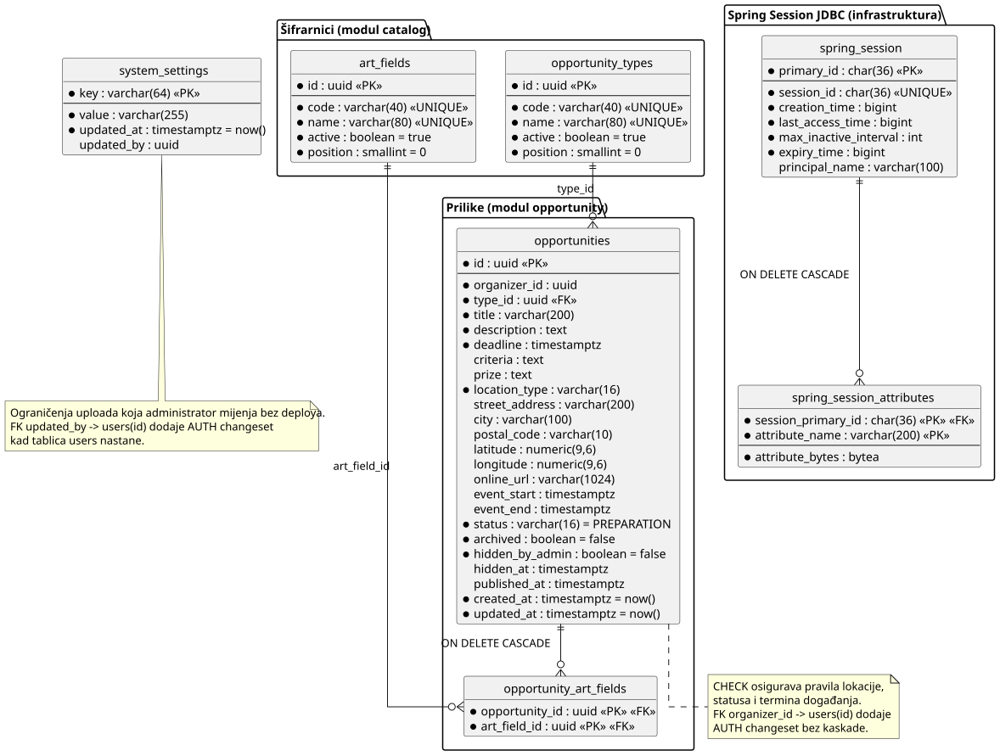

# 4. Arhitektura i oblikovanje

**Cilj:** Definirati arhitekturni stil, dekompoziciju programa na podsustave i module, organizaciju podataka te dinamičko ponašanje tijekom izvođenja. Arhitektura predstavlja temelj za implementaciju i ažurira se pri svakoj važnijoj promjeni projektnih odluka.

| Arhitekturni pogled | Ključno inženjersko pitanje | Primijenjeni model ili dijagram |
| :--- | :--- | :--- |
| **Strategija rješenja** | Koji stil i temeljne odluke određuju program? | Tablica odluka (odjeljak 4.1) |
| **Struktura podsustava** | Koji su glavni dijelovi i kako komuniciraju? | Dijagram komponenata |
| **Model podataka** | Kako su strukturirani trajni podaci programa? | Relacijski ER dijagram |
| **Struktura koda** | Kako su dodijeljene odgovornosti i ključne klase? | Reprezentativni dijagram razreda |
| **Dinamičko ponašanje** | Kako moduli surađuju pri obradi ključnih transakcija? | sekvencijski dijagram |
| **Stanja sustava** | Kako ključni domenski objekt mijenja svoja stanja? | Dijagram stanja |
| **Fizički razmještaj** | Na kojim se izvršnim čvorovima program izvodi? | Dijagram razmještaja (poglavlje 6) |

---

Za svaki UML dijagram čuvajte čitljivu sliku i PlantUML izvor, kako je opisano na stranici [Home](./Home.md). U dovršenoj stranici koristite vlastite projektne odluke i modele.

> **Stanje:** poglavlje se puni postupno. Cjelovito ga piše DOC-13 do DOC-16 (Faza 1), a svaki zadatak ažurira svoj dio u istom PR-u kao kod. Odjeljci bez sadržaja još imaju upute iz predloška; primjeri (CrisisMap) ostavljeni su kao uzor, a njihove slike učitavaju se iz [predloška kolegija](https://github.com/VladoSruk/Programsko-inzenjerstvo).

## 4.1 Strategija rješenja

**Cilj:** Objasniti nekoliko arhitekturnih odluka koje najviše utječu na rješenje i navesti njihove projektno specifične razloge.

| Odluka | Razmatrana alternativa | Projektno specifično obrazloženje i kompromis |
| --- | --- | --- |
| Geokodiranje preko backenda (ADR-03) | Nominatim poziv izravno iz preglednika | Backend centralno provodi ograničenje korištenja i skriva vanjsku integraciju od klijenta; zahtjevi se mogu odbiti ako slobodan termin nije dostupan unutar dvije sekunde. |

Objasnite glavne arhitekturne odluke bez ponavljanja popisa tehnologija. Ako važna odluka ima ADR, dovoljno je u tablici navesti njegov ID.

<details>
<summary><strong>Objašnjenje odabira</strong></summary>

**Primjer — CrisisMap:**

| Odluka | Razmatrana alternativa | Projektno specifično obrazloženje i kompromis |
| --- | --- | --- |
| Klijent u pregledniku i jedan poslužiteljski API | Više zasebno postavljenih poslužiteljskih usluga | Klijent prikazuje kartu, dok poslužiteljski sustav provjerava i pohranjuje prijave. Jedan poslužiteljski sustav upravljiv je za ovaj opseg; njegov kvar može privremeno prekinuti rad s prijavama. Obrazloženje je u ADR-01. |
| Relacijska pohrana prijava | Dokumentno orijentirana pohrana | Prijave imaju prepoznatljive veze s korisnicima i lokacijama. Relacijska shema te veze čini eksplicitnima, ali zahtijeva migracije kada se shema promijeni. |

**Analiza primjera:** Obje odluke navode razlog vezan uz aplikaciju za prijavljivanje kriznih događaja i priznaju kompromis. Odluka o poslužiteljskom sustavu upućuje na ADR-01 umjesto ponavljanja cijele usporedbe. Moduli unutar jedne aplikacije koja se postavlja kao cjelina nisu zasebne mikrousluge. U vlastitoj tablici navedite alternative koje je tim doista razmatrao.

</details>

## 4.2 Gradivni blokovi i UML dijagram komponenata

**Cilj:** Prikazati logičku podjelu programa na komponente, njihova sučelja i vanjske integracije. Dijagram komponenata prikazuje logičku organizaciju, dok dijagram razmještaja prikazuje fizičko izvođenje. Ovaj pogled ažurirajte kako sustav poprima konačan oblik.

**Dijagram komponenata:** [U izradi: DOC-13.]  
**PlantUML izvor:** [U izradi: DOC-13.]

| Komponenta | Odgovornost | Razlog za ovu granicu |
| --- | --- | --- |
| Poslužiteljska aplikacija (`backend/`, Spring Boot 4, Java 25) | REST API pod `/api/v1`, poslovna pravila, prijava i sesija, ovlaštenja, zakazani poslovi | Jedna aplikacija koja se postavlja kao cjelina; moduli su paketi unutar nje, a ne zasebne usluge. |
| Klijentski dio (`frontend/`, React + Vite + TypeScript) | Korisničko sučelje u pregledniku; poziva API preko `src/api/client.ts`; karte prikazuje pomoću Leafleta. | Prikaz i interakcija odvojeni su od poslovnih pravila; u produkciji ga Caddy servira kao statičke datoteke. |
| OpenStreetMap Tile Service (vanjski sustav) | Klijentski dio dohvaća pločice putem HTTPS-a s `https://tile.openstreetmap.org/{z}/{x}/{y}.png`; atribucija je uvijek vidljiva. | Karta koristi vanjski izvor kartografskih podataka; pločice se dohvaćaju izravno s klijenta, nisu dio baze podataka aplikacije, a pri neuspjelom učitavanju karta prikazuje upozorenje. |
| Nominatim (vanjski sustav) | Backend prima adresu preko `GET /api/v1/geocoding/search`, ograničava odlazne zahtjeve na jedan u sekundi i vraća koordinate organizatoru. | Adresa se geokodira na backendu kako klijent ne bi zaobilazio globalno ograničenje Nominatima; backend postavlja prepoznatljiv `User-Agent`, a neuspjeh vanjske usluge ne sprema se u bazu. |
| Baza podataka (PostgreSQL 17) | Trajni podaci aplikacije i sesije korisnika (Spring Session JDBC) | Podaci imaju jasne relacijske veze (korisnik, prilika, prijava); shemu verzionira Liquibase. |

### Backend: moduli i slojevi

Kod je organiziran **paket po modulu** (`hr.fer.artconnect.<modul>`). Moduli zasad postoje kao kostur (prazni paketi) i pune se uz zadatke svojih epika.

| Modul | Odgovornost |
| --- | --- |
| `auth` | Google prijava, sesija, odabir uloge, trenutni korisnik |
| `artist` | Profil umjetnika i javni portfolio |
| `artwork` | Djela u portfoliju i njihove slike |
| `opportunity` | Prilike (natječaji, izložbe, radionice): objava, pretraživanje, statusi |
| `opportunity.service.geocoding` | Geokodiranje adrese preko Nominatima; integracija je backend-only i bez trajne pohrane |
| `application` | Prijave umjetnika na prilike i odluke organizatora |
| `result` | Objava rezultata i sudjelovanja |
| `file` | Pohrana datoteka na volumenu `/data/uploads` i provjera vrste |
| `catalog` | Šifrarnici (područja umjetnosti, vrste prilika) |
| `admin` | Administracija korisnika, uloga, blokiranja i skrivanja sadržaja |
| `calendar` | Poveznica i događaj u Google kalendaru |
| `statistics` | Statistika organizatora |
| `report` | Automatski mjesečni izvještaj |
| `notification` | Obavijesti u aplikaciji (opcionalno) |
| `common` | Zajednički dijelovi: omotnica grešaka, straničenje, sigurnosna konfiguracija |

Unutar svakog modula kod je podijeljen u tri sloja:

| Sloj | Paket | Sadržaj | Pravilo |
| --- | --- | --- | --- |
| Web | `web` | Kontroleri i DTO-ovi | Prima i vraća DTO; nema poslovnih pravila; entiteti se nikad ne vraćaju iz API-ja. |
| Servis | `service` | Poslovna logika i transakcije | Provjerava poslovna pravila i vlasništvo (`CurrentUserProvider`); ovdje su transakcije. |
| Domena | `domain` | JPA entiteti i repozitoriji | Pristup bazi; bez znanja o HTTP-u. |

Ovisnosti idu prema dolje: web → servis → domena.

### Frontend: struktura

React aplikacija u `frontend/src/`, organizirana po značajkama i zajedničkim komponentama. Router i globalni MUI provider nalaze se u korijenskoj aplikaciji; zajednički izgled, stanja i lokalizacija odvojeni su od funkcionalnih stranica.

| Mjesto | Sadržaj |
| --- | --- |
| `main.tsx` | Ulazna točka i globalni MUI provider (`ThemeProvider`, `CssBaseline`) |
| `App.tsx` | Korijenska aplikacija, React Router i definicije ruta |
| `app/theme.ts` | MUI tema s dizajnerskim tokenima |
| `api/client.ts` | `apiFetch`: osnovna adresa `/api/v1`, kolačić sesije, CSRF zaglavlje `X-XSRF-TOKEN` na zahtjevima koji mijenjaju stanje, slanje JSON-a, pretvaranje svake greške (API, mreža, neočekivan odgovor) u `ApiError` |
| `components/layout/` | `AppLayout`: zaglavlje, navigacija prema ulozi, mobilni Drawer, poveznica za preskok na sadržaj, `<Outlet />`, podnožje i naslov stranice |
| `components/state/` | Zajedničke komponente učitavanja, praznog i greška stanja; stranice 403/404; statusni chipovi i globalni Snackbar (`useNotify`) |
| `features/<značajka>/` | Stranice, komponente i hookovi jedne funkcionalnosti, npr. početna stranica u `features/home/` ili `features/opportunities/` |
| `features/opportunities/components/map` | Zajednička **MapView** komponenta **(Leaflet + OpenStreetMap)** s podrškom za dinamičko učitavanje **(React.lazy)**, prikaz pojedinačnih/višestrukih oznaka te **DraggableMarkerMap** varijanta za odabir lokacije u obrascu |
| `i18n/hr.ts` | Zajednički tekstovi sučelja na hrvatskom; značajke mogu imati vlastite tekstove |

Dok AUTH-01-FE1 ne isporuči hook za dohvat trenutnog korisnika, izgled prikazuje posjetiteljsku navigaciju. Statusi prilika i prijava definirani su zasebno.

Svi pozivi backenda idu kroz `apiFetch` iz `api/client.ts`, nikad kroz vlastiti `fetch`, kako bi CSRF i obrada grešaka bili na jednom mjestu. Putanje, polja i kodovi grešaka uzimaju se iz API dokumentacije tima.

<details>
<summary><strong>Granica sustava, odgovornosti i vanjske ovisnosti</strong></summary>

**Primjer — CrisisMap:** Predložena arhitektura podržava podnošenje prijava kriznih događaja, prikaz na karti i obavijesti o potvrđenim prijavama.


**Slika 4.1. Dijagram komponenata sustava CrisisMap**

**PlantUML izvor:** [izvor](https://github.com/VladoSruk/Programsko-inzenjerstvo/blob/main/docs/puml/4-1-crisismap-system-CMP.puml)

| Dio | Odgovornost | Razlog za ovu granicu |
| --- | --- | --- |
| Web-klijent | Prikazuje prijave i prikuplja podatke za novu prijavu. | Korisnička interakcija odvojena je od pravila prijave i trajne pohrane. |
| API za prijave | Prihvaća zahtjeve za rad s prijavama i vraća odgovore. | Odgovornosti izložene putem HTTP-a odvojene su od obrade prijava. |
| Usluga za prijave | Primjenjuje pravila prijave i pristupa pohranjenim prijavama. | Pravila provjere valjanosti i pohrane prijava imaju jasno mjesto odgovornosti. |
| Proces za obavijesti | Određuje korisnike koji trebaju primiti obavijest i traži od vanjskog pružatelja da je pošalje. | Obrada obavijesti odvojena je od odgovaranja na korisnikov zahtjev za prijavu. |

**Analiza primjera:** Vanjska granica odvaja predloženi sustav od pružatelja karte i pružatelja obavijesti. Unutarnja granica grupira API za prijave, uslugu za prijave i proces za obavijesti unutar jedne poslužiteljske aplikacije; njihovi zasebni simboli prikazuju predložene odgovornosti, a ne neovisno postavljene usluge. PostgreSQL pohranjuje podatke aplikacije, dok pružatelj karte osigurava kartografske pločice. Strelice sažimaju ovisnosti, a ne redoslijed transakcije; taj redoslijed prikazuje sekvencijski dijagram. Izostavite proces za obavijesti i Firebase Cloud Messaging ako obavijesti nisu dio odobrenog opsega. Pružatelja prijave u sustav uključite samo ako to zahtijeva odobreni zadatak. Kako implementacija napreduje, ispravite svaku predloženu granicu koja se pokaže netočnom; završni dijagram mora odgovarati onome što je tim izgradio. Jedan koherentan pogled na komponente korisniji je od nekoliko gotovo jednakih inačica s proturječnim vezama.

</details>


## 4.3 Podaci i detaljno oblikovanje

**Cilj:** Objasniti važne informacije koje aplikacija pohranjuje i jedno reprezentativno područje oblikovanja na razini razreda. Model podataka i UML dijagram razreda odgovaraju na različita pitanja; jedno ne zamjenjuje drugo.

### 4.3.1 ER dijagram i model podataka

**Cilj:** Prikazati važne pohranjene entitete, njihove identifikatore i veze te dovoljno atributa za razumijevanje podataka aplikacije. ER dijagram odvojen je od reprezentativnog UML dijagrama razreda u nastavku.

**ER dijagram:**



**Slika 4.2. ER dijagram postojećih tablica**

**Izvor dijagrama:** [`docs/puml/4-2-artconnect-data-ERD.puml`](puml/4-2-artconnect-data-ERD.puml)  

**Implementacija:** Liquibase changesetovi `001-spring-session.yaml` – `009-artist-profiles.yaml` i `021-artworks-and-files.yaml` u
`backend/src/main/resources/db/changelog/changes/`; JPA entiteti `ArtField` i
`OpportunityType` u `hr.fer.artconnect.catalog.domain`, `SystemSetting` u `hr.fer.artconnect.common.domain`,
`User` i `OrganizerProfile` u `hr.fer.artconnect.auth.domain`, `ArtistProfile`, `ArtistLink` i
`PastExhibition` u `hr.fer.artconnect.artist.domain`, `StoredFile` u `hr.fer.artconnect.file.domain` te `Artwork` i `ArtworkImage` u `hr.fer.artconnect.artwork.domain`.
Tablice Spring Sessiona nemaju entitet - njima Spring Session JDBC pristupa izravno. Stavke šifrarnika se ne brišu nego isključuju (`active = false`).

Changeset `021-artworks-and-files.yaml` stvara:

| Tablica | Podaci i ograničenja |
| --- | --- |
| `stored_files` | Vlasnik (`users`, cascade), namjena `ARTWORK_IMAGE` ili `APPLICATION_ATTACHMENT`, izvorno ime, tip `image/jpeg`, `image/png` ili `application/pdf`, veličina veća od nule, jedinstveni relativni `storage_key` za volumen `/data/uploads` i vrijeme stvaranja. Datoteka se fizički briše servisom, ne bazom. |
| `artworks` | Umjetnik (`users`, cascade), naslov, godina uz CHECK `>= 1900`, tehnika, neobavezne dimenzije i opis do 5000 znakova, vidljivost `PUBLIC` ili zadano `PRIVATE`, `hidden_by_admin` i `hidden_at` te vremena stvaranja/ažuriranja. |
| `artwork_images` | Djelo i povezani redak datoteke (oba cascade), neobavezan alt tekst do 300 znakova (zadano naslov djela) i redoslijed; `file_id` je jedinstven. Najviše tri slike po djelu provodi aplikacija, ne baza. |

Indeksi: `ix_stored_files_owner (owner_id)`, `ix_artworks_artist_visibility (artist_id, visibility) WHERE hidden_by_admin = false`, `ix_artworks_artist_created (artist_id, created_at DESC)` za Moj portfolio i `ix_artwork_images_artwork (artwork_id, position)`. Dev kontekst dodaje testnom umjetniku jedno javno i jedno privatno djelo bez slika. Enum vrijednosti pohranjuju se kao varchar i provjeravaju CHECK ograničenjima.

<details>
<summary><strong>Jedna prijava poplave i povezani podaci</strong></summary>

**Primjer — CrisisMap:** Ana putem svojeg korisničkog računa podnosi prijavu poplave `R-104`. Odabire lokaciju na karti i označava razinu ozbiljnosti kao visoku. Građanin može podnijeti više prijava; svaka prijava pripada jednoj kategoriji kriznog događaja, primjerice *Poplava*. Aplikacija pohranjuje prijavu i njezine koordinate. Kartografske pločice dolaze od vanjskog pružatelja i nisu entiteti u modelu podataka aplikacije.


**Slika 4.2. ER dijagram podataka sustava CrisisMap**

**PlantUML izvor:** [izvor](https://github.com/VladoSruk/Programsko-inzenjerstvo/blob/main/docs/puml/4-2-crisismap-data-ERD.puml)

**Analiza primjera:** `R-104` ima jednog autora i jednu kategoriju; Ana i kategorija *Poplava* mogu biti povezane s više prijava. Dijagram prikazuje veze bez prepisivanja svih stupaca baze podataka ili pisanja drugog tabličnog opisa za svaki entitet. Ako aplikacija prihvaća i **anonimne** prijave, tu mogućnost prikažite u vezi s entitetom `Citizen`. Ako su kategorije fiksne vrijednosti, a ne pohranjeni zapisi, nemojte izmišljati tablicu kategorija. Završni ER dijagram usporedite s modelom trajne pohrane i objasnite samo razlike važne za razumijevanje projekta.

</details>

### 4.3.2 Reprezentativni UML dijagram razreda

**Cilj:** Prije implementacije reprezentativnog dijela sustava modelirati i prikazati razrede ili sučelja potrebna za dodjelu odgovornosti, operacija i veza. Oblikovanje ažurirajte kada se te odluke promijene.

**Dijagram razreda:** [Ugradite čitljiv UML dijagram razreda za reprezentativni dio oblikovanja.]  
**PlantUML izvor:** [Poveznica na odgovarajuću `.puml` datoteku.]  
**Referenca na kod pri završnom pregledu:** [Poveznica na odgovarajuću implementaciju.]

<details>
<summary><strong>Oblikovanje odgovornosti prijave i dopuštenih promjena</strong></summary>

**Primjer — CrisisMap:** Prijava sadrži pravila za promjenu vlastitog statusa. Razred tijeka rada koordinira podnošenje i pregled, dok sučelje repozitorija opisuje potrebne operacije trajne pohrane. Dijagram predlaže te odgovornosti prije implementacije.


**Slika 4.3. Dijagram razreda za obradu prijava kriznih događaja**

**PlantUML izvor:** [izvor](https://github.com/VladoSruk/Programsko-inzenjerstvo/blob/main/docs/puml/4-3-crisismap-domain-CD.puml)

**Analiza primjera:** `DisasterReport` sadrži dopuštena pravila promjene stanja pa tijek rada ne može prešutno odobriti već odbijenu prijavu. `ReportWorkflow` koordinira operaciju bez preuzimanja pravila prijelaza stanja same prijave; `ReportRepository` definira potrebne operacije pohrane. Kompozicija `Location` i odabrani tipovi prikazuju veze korisne za oblikovanje. Dijagram namjerno izostavlja stupce baze podataka i nepovezane razrede: ER model objašnjava pohranjene podatke, dok ovaj dijagram dodjeljuje programske odgovornosti i operacije. Ti su razredi odluka oblikovanja, a ne obavezni slojevi za svaki tim. Završnu implementaciju usporedite s početnim oblikovanjem i ažurirajte dijagram tamo gdje su se odluke promijenile; generiranje dijagrama iz koda tek na kraju ne može zamijeniti ovo početno modeliranje.

</details>

## 4.4 Ponašanje tijekom izvođenja

**Cilj:** Objasniti jednu važnu interakciju među dijelovima koji se izvode i životni ciklus jednog smislenog objekta. Odaberite primjere koji otkrivaju odluke ili neuspješne putove umjesto izrade dijagrama za svaku CRUD radnju.

### 4.4.1 Reprezentativni UML sekvencijski dijagram

**Cilj:** Prikazati redoslijed poruka za jedan reprezentativni scenarij i odgovore na važnu alternativu.

**Scenarij:** [Naziv interakcije; dodajte UC ID ako postoji.]  
**sekvencijski dijagram:** [Ugradite čitljiv UML sekvencijski dijagram.]  
**PlantUML izvor:** [Poveznica na odgovarajuću `.puml` datoteku.]

<details>
<summary><strong>Odabir lokacije, provjera valjanosti i podnošenje prijave</strong></summary>

**Primjer — CrisisMap:** Građanin podnosi prijavu kriznog događaja nakon što ručno odabere lokaciju ili zatraži položaj uređaja. Interakcija prikazuje i što se događa kada je pristup lokaciji odbijen, podaci prijave nisu valjani ili pohrana ne uspije.


**Slika 4.4. Sekvencijski dijagram podnošenja prijave kriznog događaja**

**PlantUML izvor:** [izvor](https://github.com/VladoSruk/Programsko-inzenjerstvo/blob/main/docs/puml/4-4-crisismap-report-submission-SD.puml)

**Analiza primjera:** Dva načina odabira lokacije te alternative provjere i pohrane imaju različite posljedice za korisnika; usporedite ih s odgovarajućim obrascem uporabe i njegovim alternativnim tijekovima. API preglednika za lokaciju mogućnost je preglednika; web-klijent, API, usluga i pohrana odgovaraju prikazu komponenata. Odaberite grane koje pomažu objasniti scenarij vašeg projekta i završni dijagram uskladite s implementiranom interakcijom.

</details>

### 4.4.2 Reprezentativni UML dijagram stanja

**Cilj:** Prikazati važna stanja jednog domenskog objekta ili eksplicitno upravljanog načina rada sustava te događaje ili uvjete koji ih mijenjaju.

**Vlasnik stanja i razlog odabira:** [Navedite objekt ili način rada sustava, kako se njegovo stanje prepoznaje i zašto su prijelazi važni.]  
**Dijagram stanja:** [Ugradite čitljiv UML dijagram stanja.]  
**PlantUML izvor:** [Poveznica na odgovarajuću `.puml` datoteku.]

<details>
<summary><strong>Načini rada i dostupnost usluge</strong></summary>

**Primjer — CrisisMap:** Način koordinacije kriznog događaja mijenja se kako se događaj procjenjuje i rješava. Istodobno se korisniku vidljiva dostupnost aplikacije može neovisno mijenjati kada pružatelj karte ili poslužiteljski sustav postanu nedostupni.


**Slika 4.5. Dijagram stanja prijave kriznog događaja**

**PlantUML izvor:** [izvor](https://github.com/VladoSruk/Programsko-inzenjerstvo/blob/main/docs/puml/4-5-crisismap-report-SM.puml)

**Analiza primjera:** Dvije regije opisuju neovisne aspekte modeliranog sustava: način koordinacije kriznog događaja i opaženu dostupnost usluge. Izvode se paralelno; aktivni krizni događaj može postojati uz normalno ili ograničeno pružanje usluge. Grane nakon oporavka poslužiteljskog sustava uzimaju u obzir da pružatelj karte možda i dalje nije dostupan. Prijelazi stanja imaju imenovane okidače ili uvjete umjesto da budu samo popis zaslona. Ovaj oblik koristite samo ako aplikacija stvarno održava ili pouzdano izvodi obje vrste stanja. Projekt čiji važan životni ciklus pripada prijavi, rezervaciji ili narudžbi treba modelirati taj objekt; složenost dijagrama nije kriterij vrednovanja. Pri završnom pregledu model stanja usporedite s ponašanjem koje pokrenuta aplikacija stvarno podržava.

</details>

## 4.5 Zapisi arhitekturnih odluka

**Cilj:** Sačuvati razloge i obrazložiti odabrane važne arhitekturne odluke kada tablica u odjelku 4.1 nije dovoljna za očuvanje konteksta, razmatranih alternativa i prihvaćenih kompromisa.

Napišite nekoliko ADR-a samo za važne odluke čije obrazloženje, alternative i kompromis treba sačuvati. Ostale arhitekturne odluke dovoljno je zabilježiti u tablici.

**Detaljni zapis arhitekturne odluke (engl. Architecture Decision Record, ADR), kada odluka zahtijeva dodatno objašnjenje:**

### ADR-[ID]: [Naslov odluke]

| Polje | Zapis odluke |
| --- | --- |
| Kontekst i cilj | [Koji je arhitekturni problem učinio ovu odluku potrebnom?] |
| Kriteriji odluke | [Što je timu stvarno bilo važno?] |
| Razmatrane alternative | [Realne mogućnosti koje je tim razmotrio, ukratko.] |
| Odluka i obrazloženje | [Odabrana mogućnost, zašto je odabrana i čega se tim odrekao.] |
| Status | [Predloženo, prihvaćeno ili zamijenjeno; ako je primjenjivo, poveznica na novu odluku.] |

ADR pišite samo za odluku čije će obrazloženje ostati važno i nakon promjene implementacije. Značajna promjena odluke može se zabilježiti novim ADR-om koji zamjenjuje stari; rutinski odabiri alata ne trebaju detaljne zapise. Promjene dogovorenog opsega pripadaju zahtjevima i njihovoj povijesti promjena; povratna informacija o zadatku ostaje uz odgovarajući zadatak.

### ADR-01: Poslužiteljska sesija umjesto JWT-a

| Polje | Zapis odluke |
| --- | --- |
| Kontekst i cilj | React aplikacija treba pamtiti prijavu, a backend treba moći poništiti sesije korisnika. |
| Razmatrane alternative | Poslužiteljska sesija u PostgreSQL-u ili JWT pristupni tokeni. |
| Odluka i obrazloženje | Koristimo Spring Session JDBC i kolačić `SESSION`. Već imamo PostgreSQL, a sesije možemo dohvatiti po korisniku i obrisati. Ne trebamo uvoditi osvježavanje i opoziv JWT tokena. |
| Kompromis | Backend pri radu sa sesijom pristupa bazi. Za zahtjeve koji mijenjaju podatke potrebna je CSRF zaštita. |
| Status | Prihvaćeno u FND-04 (#9). |

<details>
<summary><strong>Odabir jednog poslužiteljskog sustava umjesto zasebno postavljenih usluga</strong></summary>

**Primjer — CrisisMap, ADR-01:**

| ID | Datum | Odluka | Razmatrana alternativa | Obrazloženje i kompromis | Status |
| --- | --- | --- | --- | --- | --- |
| ADR-01 | [Datum odluke] | Jedan poslužiteljski API za obradu prijava | Zasebno postavljene usluge za prijave i resurse | Manji napor postavljanja i integracije za odobreni opseg; kvar poslužiteljskog sustava može utjecati na obje funkcionalnosti. | Prihvaćeno |

### ADR-01: Jedan poslužiteljski API za obradu prijava

| Polje | Zapis odluke |
| --- | --- |
| Kontekst i cilj | Tim tijekom jednog semestra mora izraditi i javno postaviti prijavljivanje kriznih događaja i prikaz usmjeren na kartu. |
| Kriteriji odluke | Tim može izraditi, integrirati, postaviti i objasniti rješenje; komponente i dalje imaju prepoznatljive odgovornosti. |
| Razmatrane alternative | **Jedan poslužiteljski sustav:** moduli dijele aplikaciju koja se postavlja kao cjelina. **Zasebne usluge:** svaka se može izvoditi neovisno, ali zahtijeva dodatni rad na integraciji i postavljanju. |
| Odluka i obrazloženje | Odabrati jedan poslužiteljski sustav s jasno odvojenim odgovornostima vezanim uz prijave. Time se smanjuje rad na postavljanju, uz prihvaćanje da kvar tog sustava može istodobno utjecati na rad s prijavama. |
| Status | Prihvaćeno. |

**Analiza primjera:** Strategija rješenja navodi trenutačni pristup; ADR-01 čuva alternative i kriterije koji su do njega doveli. Dijagrami komponenata i razmještaja trebaju odražavati odabrani pristup kako se sustav razvija. Zaseban ADR koristan je za važnu odluku, a ne za svaki odabir alata.

</details>

### ADR-02: OpenStreetMap + Leaflet umjesto Google Mapsa

| Polje | Zapis odluke |
| --- | --- |
| Kontekst i cilj | Prikaz lokacija prilika i odabir lokacije zahtijevaju interaktivnu kartu u React klijentskoj aplikaciji. Za projektni opseg i očekivano opterećenje rješenje treba biti jednostavno za postavljanje bez uspostavljanja računa za naplatu kod kartografskog pružatelja. |
| Kriteriji odluke | Rješenje mora podržavati oznake i odabir lokacije, integrirati se s Reactom te prikazivati izvor podataka. Prednost ima rješenje koje ne zahtijeva API ključ ni račun s omogućenim obračunom po korištenju i čije postavljanje ne uvodi dodatnu kartografsku naplatu u projektnom opsegu. |
| Razmatrane alternative | **Google Maps** kao kartografski servis te **OpenStreetMapove** pločice prikazane pomoću **Leafleta**. |
| Odluka i obrazloženje | Odabrati **Leaflet** s javnim pločicama **OpenStreetMapa**. Leaflet je klijentska biblioteka bez kartografskog API ključa, a javni OSM Tile Service za ovaj opseg ne zahtijeva projektni račun za naplatu ni obračun po korištenju kao Google Maps Platform. Time se pojednostavljuje postavljanje i izbjegava konfiguracija Googleovih vjerodajnica i naplate; Leaflet se učitava lijeno kako ne bi ulazio u početni paket. Pločice se dohvaćaju s `https://tile.openstreetmap.org/{z}/{x}/{y}.png`, uz vidljivu atribuciju. Kompromis je ovisnost o javnom servisu bez jamstva dostupnosti, uz obvezu poštivanja njegove politike korištenja pločica; za veće opterećenje treba ponovno procijeniti pružatelja. |
| Status | Prihvaćeno. |

### ADR-03: Geokodiranje preko backenda (Nominatim)

| Polje | Zapis odluke |
| --- | --- |
| Kontekst i cilj | Organizatoru treba pretvorba adrese prilike u koordinate. Nominatim zahtijeva poštovanje ograničenja od jednog zahtjeva u sekundi za cijelu aplikaciju. |
| Kriteriji odluke | Zahtjev mora biti ograničen globalno, koristiti prepoznatljiv `User-Agent`, ne izlagati vanjski servis pregledniku i omogućiti determinističko testiranje bez mrežnog poziva javnoj usluzi. |
| Razmatrane alternative | Izravni poziv iz preglednika ili poziv iz backenda s centralnim ograničivačem i konfigurabilnim Nominatim URL-om. |
| Odluka i obrazloženje | Odabrati backend poziv `GET /search` preko Spring `RestClient`. Jedan `ReentrantLock` ograničava pozive cijelog procesa, a `Clock` i konfiguracija omogućuju testiranje i razvoj preko lažnog poslužitelja. Organizatori, uključujući one na čekanju, mogu geokodirati prilike u pripremi; odobrenje se zasebno provjerava pri objavi prilike. |
| Kompromis | Svi geokodirajući zahtjevi čekaju zajednički raspoloživi termin; ako termin nije dostupan unutar dvije sekunde ili Nominatim ne odgovori, korisnik dobiva odgovarajuću grešku i može ručno odabrati lokaciju. Javni Nominatim nema jamstvo dostupnosti. |
| Status | Prihvaćeno u OPP-01-BE3. |

### ADR-04: Pohrana datoteka na Docker volumenu

| Polje | Zapis odluke |
| --- | --- |
| Kontekst i cilj | Slike djela i budući prilozi prijava moraju biti pohranjeni odvojeno od poslovne logike i opstati pri zamjeni backend kontejnera. |
| Kriteriji odluke | Pohrana treba imati jedinstvene ključeve, metapodatke u `stored_files`, sigurne putanje, očuvanje nakon ponovnog pokretanja i provjeru stvarnog tipa datoteke bez povjerenja u klijentska zaglavlja. |
| Razmatrane alternative | Datoteke kao binarni podaci u PostgreSQL-u, lokalna putanja unutar kontejnera ili zajednički direktorij na trajnom Docker volumenu. |
| Odluka i obrazloženje | Koristiti `FileStorageService` s korijenom `artconnect.storage.root`, UUID nazivima i metapodacima u `stored_files`; u produkciji montirati imenovani volumen `uploads` na `/data/uploads`. Binarne podatke ne spremati u PostgreSQL jer bi povećavali bazu i sigurnosne kopije te opteretili bazu pohranom i dohvatom sadržaja datoteka. Lokalna putanja unutar kontejnera nije dovoljna jer bi se datoteke izgubile pri zamjeni kontejnera. Imenovani Docker volumen opstaje neovisno o životnom vijeku kontejnera. Lokalni backend izvan Dockera koristi `./data/uploads`. Tip se određuje po JPEG, PNG ili PDF magic bytes. |
| Kompromis | Baza i datotečni sustav ne dijele jednu atomsku transakciju; privremene datoteke, atomsko premještanje i callbackovi transakcije ograničavaju rizik nekonzistentnosti. Docker volumen opstaje nakon zamjene kontejnera, ali zahtijeva zasebnu sigurnosnu kopiju i oporavak. |
| Status | Prihvaćeno u PORT-04-BE1 (#104). |

## 4.6 Koncepti koji prožimaju sustav

Paket `hr.fer.artconnect.common` sadrži zajedničke klase za greške, provjeru podataka i straničenje (#8).

### Sesija i sigurnost

`SecurityConfig` dopušta anonimne GET zahtjeve na prilike, umjetnike, djela, datoteke, šifrarnike, javne postavke, `/api/v1/auth/csrf` i `/actuator/health`. Ostali zahtjevi traže prijavu. `@EnableMethodSecurity` uključuje provjere `@PreAuthorize`; privatnost pojedinog djela ili datoteke mora dodatno provjeriti odgovarajuća metoda.

`CurrentUser(UUID id, Role role, Status status)` je zajednički principal prijavljenog korisnika. Serijalizira se u JDBC sesiju, a `getName()` vraća ID korisnika za dohvat njegovih sesija. `role` može biti `null` tijekom onboardinga. Ovo nije DTO odgovora `GET /me`; podatke profila dodat će AUTH zadaci. Kontroler prima `@AuthenticationPrincipal CurrentUser user`, a servis poziva `currentUserProvider.getCurrentUser()`. Bez valjanog principala provider javlja 401 `UNAUTHENTICATED`.

`RoleHierarchy` je spojen na provjere `@PreAuthorize`. Prema dogovoru, uloge ostaju odvojene: `ADMIN` ne nasljeđuje automatski prava `ARTIST` i `ORGANIZER`. `UserStatusFilter` je uključen u sigurnosni lanac prije odluke o pristupu, ali zasad samo propušta zahtjev. Provjere `ONBOARDING_REQUIRED` i `USER_BLOCKED` pripadaju kasnijim zadacima EPIC-01 i EPIC-08.

Spring Session JDBC sprema sesije u postojeće tablice PostgreSQL-a. Sesija istječe nakon 8 sati neaktivnosti. Kolačić `SESSION` ima `HttpOnly` i `SameSite=Lax`, a u profilu `prod` i `Secure`. Springov `FindByIndexNameSessionRepository` dostupan je za kasnije poništavanje sesija korisnika.

Frontend prvo poziva `GET /api/v1/auth/csrf`. Odgovor sadrži `headerName` i `token` te postavlja JavaScriptu čitljiv kolačić `XSRF-TOKEN`. Pri POST, PUT, PATCH i DELETE zahtjevima klijent šalje njegovu vrijednost u `X-XSRF-TOKEN`. Nakon buduće prijave ili odjave klijent treba ponovno dohvatiti token. CSRF izuzetak vrijedi samo za `/api/v1/dev/**` u profilu `dev`, bez aktivnog profila `prod`; ne ukida zahtjev za prijavom.

`SecurityErrorHandler` obrađuje greške u filtrima. Zajedno s `GlobalExceptionHandlerom` koristi istu JSON omotnicu i hrvatske poruke: anonimnom korisniku bez pristupa vraća 401 `UNAUTHENTICATED`, a prijavljenom bez ovlasti 403 `FORBIDDEN`. Izostavljen ili nevaljan CSRF token uvijek vraća 403 `FORBIDDEN`.

Testovi u paketu `auth` uključuju sigurnosne filtre i provjeravaju tok CSRF kolačića i zaglavlja, odvojene uloge, razvojni izuzetak te dohvat principala u kontroleru i servisu. `SessionIntegrationTest` uz Testcontainers PostgreSQL provjerava učitavanje `CurrentUser` principala iz baze, dohvat sesija po ID-u korisnika, postavljeno trajanje od 8 sati, odbijanje istekle sesije i produkcijske kolačiće. Dodatna lokalna provjera 18. 10. 2026. potvrdila je da isti kolačić sesije vrijedi nakon gašenja i ponovnog pokretanja procesa backenda uz istu bazu. Postupak i rezultati zapisani su u [poglavlju o ispitivanju](5-Ispitivanje.md#provjera-fnd-04--18-10-2026).

### Greške i provjera podataka

Servis javlja očekivanu grešku ovako: `throw new ApiException(ErrorCode.NOT_FOUND, "Prilika nije pronađena.");` Po potrebi dodaje popis `FieldIssue(field, issue)`. `ErrorCode` sadrži svih 30 API kodova i njihove HTTP statuse.

`GlobalExceptionHandler` vraća `{ "error": { "code": "...", "message": "...", "details": [...] } }`. Prazan `details` izostavlja se. Neispravni podaci vraćaju 400 `VALIDATION_ERROR`, prevelika datoteka 413 `FILE_TOO_LARGE`, a zabrana pristupa 401 za anonimnog korisnika ili 403 za prijavljenog bez ovlasti. Neočekivana greška vraća 500 `INTERNAL_ERROR` s općom porukom; detalji iznimke ostaju samo u logu.

Springove HTTP greške zadržavaju izvorni status i zaglavlja: nepostojeća putanja vraća 404 `NOT_FOUND`, pogrešna metoda 405 `VALIDATION_ERROR`, a nepodržani `Content-Type` 415 `UNSUPPORTED_FILE_TYPE`. Iznimka `ResponseStatusException` također zadržava zadani status, uz sigurnu hrvatsku poruku. Klijentske greške ne zapisuju se kao greške poslužitelja; iznimke sa statusom 5xx zapisuju se u log.

DTO-i koriste Jakarta Validation i `@Valid`. Hrvatski jezik postavlja `CommonWebConfiguration`, a poruke su u `messages_hr.properties`. Kod neispravnog JSON-a polje u detaljima je `body`. Sigurnosne greške koje nastanu prije kontrolera obrađuje `SecurityErrorHandler`; `GlobalExceptionHandler` obrađuje iznimke koje stignu do MVC-a.

### Straničenje i sortiranje

Kontroler prima `@Valid @ModelAttribute PageRequestParams params` i opcionalni `sort`. Zadano je `page=1`, `pageSize=20`. Stranica mora biti najmanje 1, a veličina između 1 i 100; inače se vraća 400. Primjer korištenja:

```java
Sort order = SortParser.parse(sort, Set.of("deadline"));
Pageable pageable = params.toPageable(order);
return PageResponse.from(service.find(pageable));
```

`deadline` znači uzlazno, `-deadline` silazno. Svaki endpoint predaje svoja dopuštena polja. Bez parametra parser vraća `Sort.unsorted()`; zadani redoslijed bira endpoint. `toPageable` pretvara broj stranice iz API-ja u Springov broj od 0. `PageResponse.from` prima straničeni `Page` s DTO-ima i vraća `{ "data": [...], "meta": { "page": 1, "pageSize": 20, "total": 134 } }`.

### Postavke i testovi

DTO-i s vremenom koriste `OffsetDateTime`. Postavke Jacksona 3 u `application.yml` osiguravaju ISO-8601 tekst i čuvanje vremenskog pomaka. Multipart dopušta 50 MB po datoteci i 51 MB po zahtjevu, prema zadatku [PORT-04-BE1 #104](https://github.com/LD05-fk/Strumfovi/issues/104). Stvarne limite prema namjeni provjeravat će servis iz `system_settings`.

Testovi u `backend/src/test/java/hr/fer/artconnect/common` provjeravaju greške kroz MockMvc, hrvatske poruke, datume, straničenje i sortiranje. Test uploada provjerava obradu iznimke; stvarni upload pripada zadatku za datoteke. Iz `backend` pokrenuti `./mvnw -B verify` uz Javu 25 i Docker. Samo ovi testovi mogu se pokrenuti bez Dockera: `./mvnw -B '-Dtest=hr.fer.artconnect.common.*Test' verify`.

### Korisničko sučelje i pristupačnost

Vizualni jezik definira zadatak FND-06-DES (#11). Dizajn je isporučen kao dokumentacija u repozitoriju. Nacrt je u [`design-system/`](design-system/): [`tokens.md`](design-system/tokens.md) (tablice tokena), [`theme.ts`](design-system/theme.ts) (MUI tema, polazište za frontend) i [`preview.html`](design-system/preview.html) (pregled komponenata i wireframeova, otvara se u pregledniku).

Sučelje se gradi na MUI-ju, a svi ekrani koriste iste tokene:

- **Boje:** primarna `#4338CA`, sekundarna `#BE185D`, pozadina `#FAFAF9`, površina `#FFFFFF`, tekst `#1C1917` / `#57534E`, greška `#B91C1C`, upozorenje `#B45309`, uspjeh `#15803D`. Kontrast teksta je svugdje najmanje 4.5:1.
- **Tipografija:** Inter (podržava hrvatske dijakritike), naslovi h1–h6 od 36 do 16 px, osnovni tekst 16/24 px, gumbi bez velikih slova.
- **Razmaci i oblici:** MUI `spacing` 8 px; radijusi 8 px (gumbi, polja), 12 px (kartice), 16 px (chip, dijalog).
- **Prijelomne točke:** xs < 600, sm 600–899, md ≥ 900 px.
- **Statusi:** prilike (`PREPARATION`…`FINISHED`) i prijave (`SUBMITTED`…`WITHDRAWN`) prikazuju se chipom s hrvatskim tekstom i bojom; status se nikad ne prenosi samo bojom.
- **Početna stranica i navigacija:** početna stranica prikazuje naslov i opis ArtConnecta te akcije „Prijava s Googleom” i „Pregledaj prilike”. Posjetitelj na md+ vidi „Prilike” i punu oznaku prijave; na xs/sm navigacija je u draweru, a na xs gumb prijave prikazuje samo Google oznaku. Umjetnik vidi „Portfolio” i „Moje prijave”; organizator „Moje prilike” i „Statistika”; administrator „Administracija”; prijavljeni korisnik ima izbornik „Profil” / „Odjava”. Drawer se zatvara tipkom Esc.
- **Izgled:** zaglavlje, glavni sadržaj i podnožje protežu se punom širinom viewporta; rubni razmak je 16 px na xs i 24 px na sm/md.

Pristupačnost: sučelje je na hrvatskom (`<html lang="hr">`), postoji poveznica „Preskoči na sadržaj”, a interaktivni elementi dostupni su tipkovnicom s vidljivim fokusom (prsten 3 px u primarnoj boji). Dizajnerski cilj za dodirne površine je najmanje 44 × 44 px; kompaktni gumb prijave u zaglavlju trenutačno je manji. Polja obrasca trebaju imati oznaku i poruku greške povezanu s poljem.

## 4.7 Arhitekturni rizici i tehnički dug

**Cilj:** Navesti stvarne tehničke ili domenske rizike i svjesno prihvaćene kompromise oblikovanja, njihove posljedice i način na koji ih tim obrađuje.

**Tehnički rizici i dug**

| Rizik ili kompromis | Posljedica | Trenutačni pristup |
| --- | --- | --- |
|  |  |  |

**Poslovni ili domenski rizici, ako su značajni**

| Rizik | Posljedica | Trenutačni pristup |
| --- | --- | --- |
|  |  |  |

<details>
<summary><strong>Prepoznavanje ograničenja bez izmišljanja produkcijske infrastrukture</strong></summary>

**Primjer — CrisisMap, tehnički rizici:**

| Rizik ili kompromis | Posljedica | Trenutačni pristup |
| --- | --- | --- |
| Jedna instanca aplikacije obrađuje podnošenje prijava. | Kvar smještaja aplikacije privremeno onemogućuje nove prijave. | Prihvaćeno u okviru projekta kolegija; tim ne tvrdi da postoji automatsko prebacivanje na pričuvni sustav. |
| Vanjske kartografske pločice nisu dostupne. | Prikaz karte može prestati raditi iako su pohranjene prijave i dalje dostupne. | Objasnite korisniku vidljivu pogrešku ili alternativu koju implementirana aplikacija stvarno pruža. |

**Primjer — CrisisMap, domenski rizik:** Čitatelji mogu neprovjerenu prijavu građanina zamijeniti za službeno upozorenje. Tim može u sučelju jasno razlikovati status provjere prijave i uputiti korisnike na službene izvore.

**Analiza primjera:** Prvi tehnički rizik prihvaća realistično ograničenje projekta kolegija; domenski se rizik odnosi na način na koji čitatelj tumači prijavu. Zabilježite ograničenje i realan odgovor koji pripadaju vašem projektu. Neostvarena obavezna funkcionalnost nije tehnički dug nego nedovršen opseg.

</details>

**Završna provjera:** Usporedite dijagrame komponenata, podataka, razreda, sekvencijski dijagram i dijagram stanja s implementiranim kodom, ponašanjem aplikacije i stvarnim razmještajem. Ažurirajte zastarjele opise oblikovanja i objasnite svaku važnu razliku koja ostaje; poveznice na odgovarajući kod ili ispitivanja korisne su kada odgovaraju na konkretno pitanje.
